### `> whoami`

I'm **Sergio Cervilla**, an AI engineer who builds agents and the plumbing that makes them useful.

- 🧠 Built a **RAG-powered medical triage agent** that cut the process time by **87%**
- ⚙️ Automated hardware–software workflows at **Sirius**, Brazil's synchrotron light source (**−70%** manual intervention)
- 📈 Designed an **ML ensemble for the Ibovespa** with backtested returns of up to **18.05%**
- 🔬 Deep learning + **explainable AI** for bioprocesses at CNPEM · 🏆 Dawn Legion Award in Machine Learning
- 🎓 Currently: **MSc in AI, Automation & Digital Agents** @ Next — Madrid 🇪🇸
- 🗣️ Português · English · Español

<b>⚡ Why "talosmith"?</b>

 

In Greek myth, **Talos** was a bronze giant forged by Hephaestus to guard Crete: the first automaton, a machine that acted on its own.
A single vein of *ichor* ran through his body and kept him alive.

I build the modern version: agents that act on their own, with data as the ichor.
**talos** + **smith** → the one who forges them.

### `> ls ~/forge`

| | Project | What it does | Stack |
|:-:|---|---|---|
| 📨 | **[hermes-agenda](https://github.com/talosmith/hermes-agenda)** | WhatsApp agent that books therapy sessions and sends reminders | Python · LLM agents · WhatsApp Cloud API |
| ⚕️ | **[asclepius-triage](https://github.com/talosmith/asclepius-triage)** | RAG agent for medical triage | LangChain · vector DB · FastAPI |
| 🔮 | **[delphi-ibov](https://github.com/talosmith/delphi-ibov)** | ML ensemble that forecasts the Ibovespa, with full backtesting | XGBoost · LightGBM · scikit-learn |
| 🛠️ | **[talos-mcp](https://github.com/talosmith/talos-mcp)** | MCP server that gives AI agents real tools | Python · MCP |

🔨 All of these are on the anvil this week. New repos land here first.

### `> cat stack.txt`

  

  
  
  
  
  
  
  

### `> tail -f activity.log`

  <picture>
    <source media="(prefers-color-scheme: dark)" srcset="https://raw.githubusercontent.com/talosmith/talosmith/output/snake-dark.svg"/>
    
  </picture>

### `> ping talosmith`

ΤΑΛΩΣ // forged in bronze, running on ichor

